# Task 3 – Secure Coding Review

## Project Overview

This project was completed as part of the CodeAlpha Cyber Security Internship (November 2026).

The objective was to develop a small PHP and MariaDB web application, identify security vulnerabilities through static code analysis and manual inspection, and implement secure coding practices to mitigate the identified risks.

## Technologies Used

- PHP 8.1
- MariaDB
- Apache2
- Ubuntu 22.04
- Semgrep
- PDO (PHP Data Objects)

## Application Features

- User registration
- User authentication
- User search
- MariaDB database integration

## Security Assessment

The initial application was intentionally developed with security weaknesses for educational testing.

The audit identified:

1. **SQL Injection:** User input was directly inserted into SQL queries.
2. **Plaintext Password Storage:** Passwords were stored without hashing.
3. **Stored Cross-Site Scripting (XSS):** User-controlled content was rendered without HTML escaping.
4. **Insecure Configuration Management:** Database credentials were stored inside the web application directory.

## Security Improvements

The following measures were implemented:

- PDO prepared statements to prevent SQL injection.
- `password_hash()` and `password_verify()` for password protection.
- `htmlspecialchars()` to prevent stored XSS.
- PHP session ID regeneration after successful authentication.
- Input validation for usernames, email addresses and passwords.
- Database configuration moved outside the web root.
- Restricted file permissions for database configuration.

## Testing and Results

The application was tested before and after remediation.

| Security Test | Final Result |
|---|---|
| SQL Injection | Successfully mitigated |
| Password Hashing | Verified |
| Stored XSS | Successfully mitigated |
| Authentication | Successful |
| Semgrep Static Analysis | 0 findings |

Semgrep executed 85 rules and scanned 4 files during the final analysis.

## Project Structure

```text
Task-3-Secure-Coding-Review/
├── src/
│   ├── index.php
│   ├── register.php
│   ├── login.php
│   ├── search.php
│   └── db.example.php
├── docs/
├── screenshots/
├── .gitignore
└── README.md
```

## Installation

1. Install PHP 8.1, Apache2, MariaDB and the required PHP extensions.
2. Create a database named `secure_coding_db`.
3. Create the required `users` table.
4. Copy the example configuration file:

   `cp src/db.example.php src/db.php`

5. Edit `src/db.php` and replace the placeholders with your local database credentials.
6. Configure Apache to serve the application from the `src` directory.
7. Open the application in your browser and perform the security tests.

**Important:** Never publish real database credentials or deploy the intentionally vulnerable initial version in a production environment.
## Conclusion

This project demonstrates the importance of secure coding practices throughout the software development lifecycle. Static analysis and manual testing helped identify vulnerabilities, while remediation and retesting improved the application's security posture.

## Author

**Astan Mve Sidibé**  
Master 1 Student in Information Systems Security  
ESMT – Senegal

CodeAlpha Cyber Security Internship – November 2026

## Screenshots

### 1. Initial Application and Vulnerability Assessment

**Initial application**
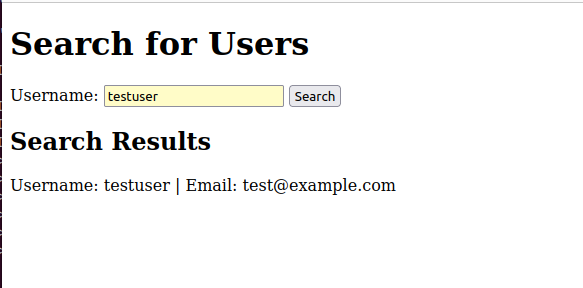

**Initial Semgrep security scan**
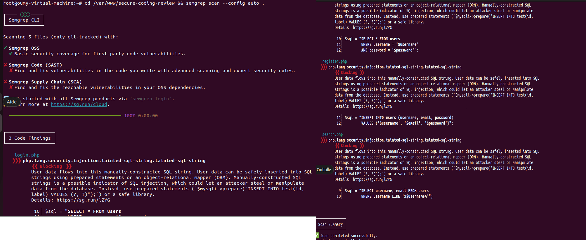

**Plaintext password storage**
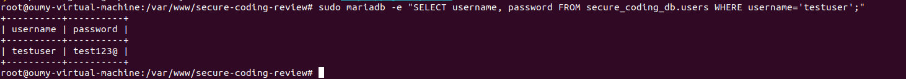

**Stored XSS vulnerability**
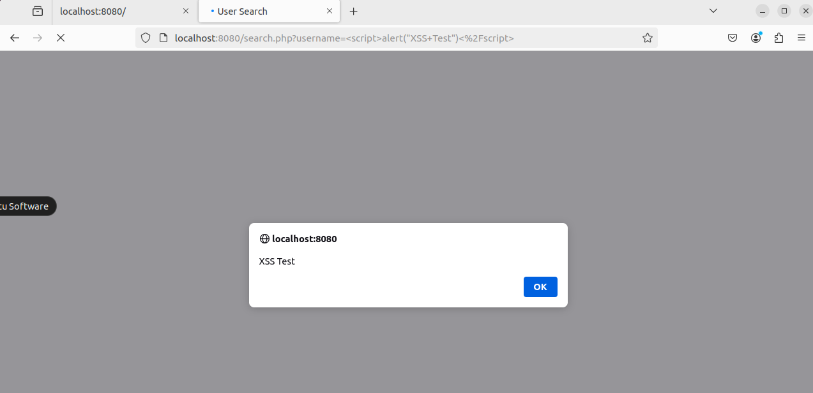

### 2. Security Remediation

**Secure user registration**
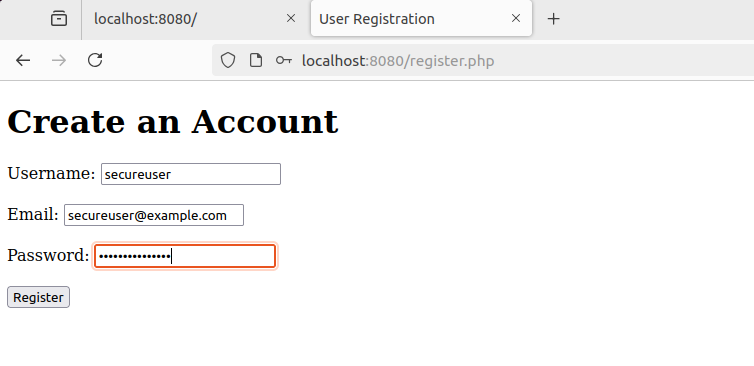

**Password hashing verification**
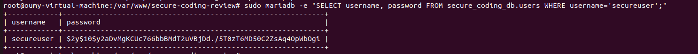

**Secure user authentication**
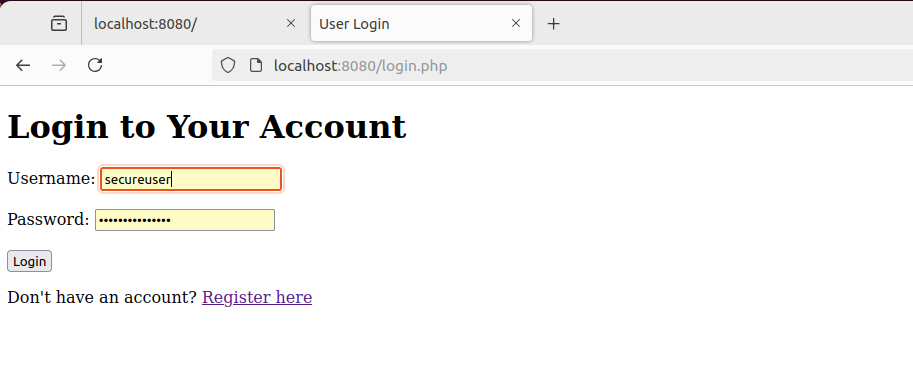

**Stored XSS mitigation**
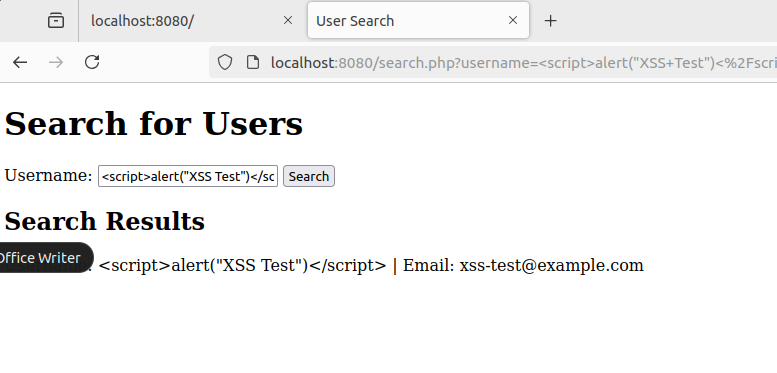

### 3. Final Security Tests

**SQL injection test**
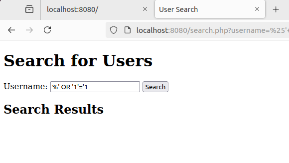

**Final Semgrep scan – zero findings**
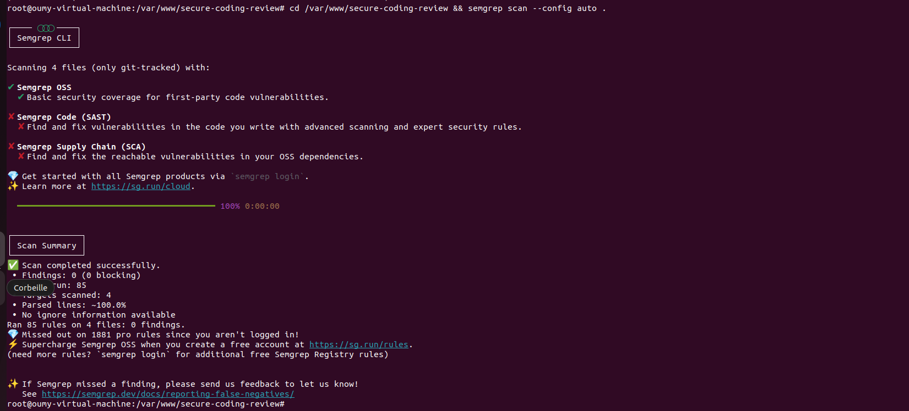

**Secure database configuration and file permissions**
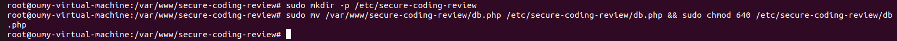
