# Security Audit and Secure Coding Review Report

**Project:** CodeAlpha Task 3 – Secure Coding Review  
**Author:** Astan Mve Sidibé  
**Internship:** CodeAlpha Cyber Security Internship – November 2026  
**Environment:** Ubuntu 22.04.5 LTS, PHP 8.1, Apache2, MariaDB  
**Static Analysis Tool:** Semgrep 1.185.0

---

## 1. Introduction

The purpose of this project was to perform a security review of a PHP web application, identify common security vulnerabilities, and apply secure coding practices to mitigate them.

The application was developed in a controlled local laboratory environment using PHP and MariaDB. The assessment combined automated static code analysis with manual security testing.

## 2. Application Description

The application provides three main features:

- User registration.
- User authentication.
- User search.

The application uses PHP 8.1, MariaDB, Apache2 and PDO for database connectivity.

**Evidence – Initial application:**

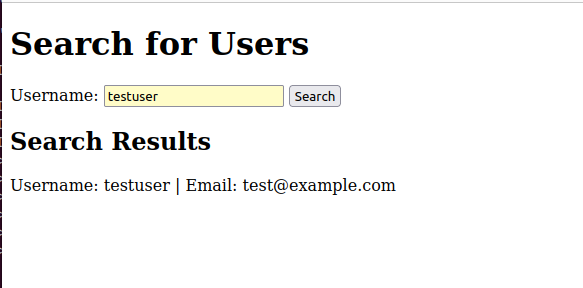

## 3. Audit Methodology

The security assessment was conducted in four phases:

1. **Application setup:** Installation and configuration of the PHP, Apache and MariaDB environment.
2. **Initial security audit:** Inspection of the source code using Semgrep and manual testing.
3. **Remediation:** Modification of vulnerable code using secure coding practices.
4. **Final validation:** Re-execution of security tests and static analysis.

## 4. Tools and Technologies

| Tool / Technology | Purpose |
|---|---|
| Ubuntu 22.04 | Operating system |
| PHP 8.1 | Application development |
| MariaDB | Database management |
| Apache2 | Web server |
| Semgrep 1.185.0 | Static application security testing |
| PDO | Secure database access |
| Browser | Manual application testing |

## 5. Initial Security Findings

The initial application contained several security weaknesses.

### 5.1 SQL Injection

**Affected files:** `register.php`, `login.php`, `search.php`

**Description:** User-controlled input was directly concatenated into SQL statements. This could allow an attacker to manipulate database queries.

**Evidence:** The initial Semgrep scan detected three SQL injection findings.

**Risk:** Unauthorized database access, data disclosure or modification.

**Evidence – Initial Semgrep scan:**

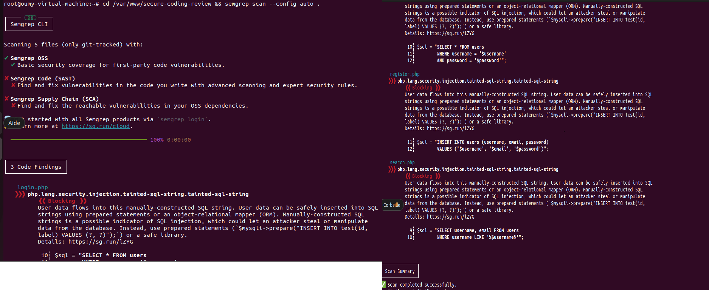
### 5.2 Plaintext Password Storage

**Affected file:** `register.php`

**Description:** Passwords were stored directly in the database without hashing.

**Evidence:** Manual database inspection confirmed that the test account password was stored in readable form.

**Risk:** Anyone obtaining access to the database could read stored passwords.

**Evidence – Plaintext password storage:**

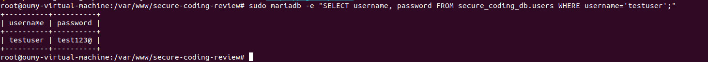

### 5.3 Stored Cross-Site Scripting (XSS)

**Affected file:** `search.php`

**Description:** User-controlled database content was displayed without HTML output encoding.

**Evidence:** A controlled JavaScript alert test successfully executed in the browser.

**Risk:** Malicious scripts could execute in the context of a user's browser.

**Evidence – Stored XSS vulnerability:**

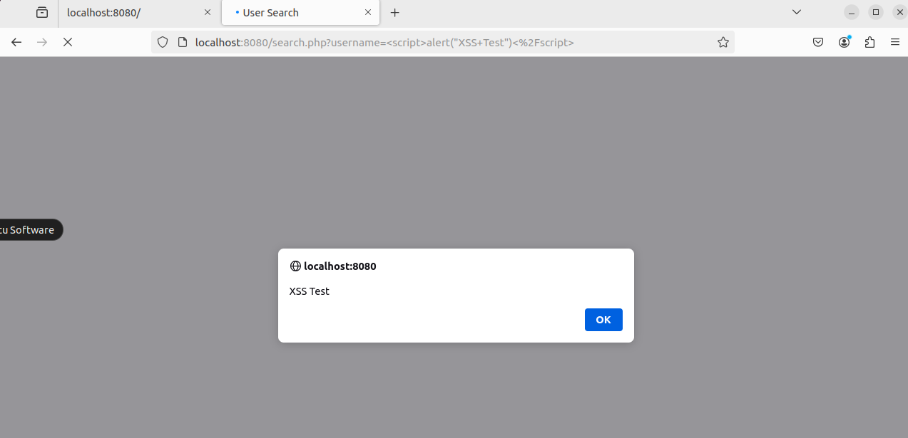

### 5.4 Insecure Database Configuration

**Affected file:** `db.php`

**Description:** Database credentials were initially stored inside the web application's document root.

**Risk:** Improper server configuration could expose sensitive connection information.

## 6. Security Remediation

The following improvements were implemented.

### 6.1 SQL Injection Prevention

PDO prepared statements replaced direct SQL string concatenation.

Example:

```php
$stmt = $pdo->prepare(
    "SELECT id, username FROM users WHERE username = :username"
);
$stmt->execute(['username' => $username]);

This approach separates SQL instructions from user-supplied values, reducing the risk of SQL injection.


### 6.2 Secure Password Storage

The application initially stored passwords in plaintext. This weakness was corrected using PHP's `password_hash()` function during registration and `password_verify()` during authentication.

Example:

```php
$hashedPassword = password_hash($password, PASSWORD_DEFAULT);

This ensures that passwords are stored as secure hashes rather than readable text.

**Evidence – Secure registration:**

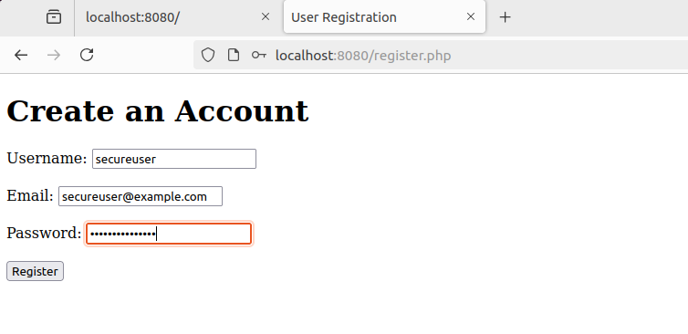

**Evidence – Password hashing in the database:**

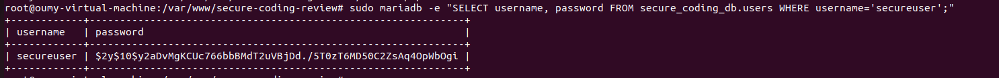

### 6.3 Authentication and Session Security

The login process was improved to verify password hashes using `password_verify()`. The application also regenerates the session ID after successful authentication using `session_regenerate_id(true)`.

This helps reduce the risk of session fixation attacks.

**Evidence – Successful secure login:**

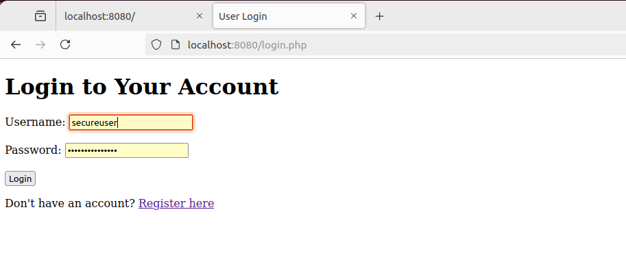

### 6.4 Cross-Site Scripting (XSS) Prevention

The application initially displayed user-controlled content without proper HTML encoding. This vulnerability was corrected by using PHP's `htmlspecialchars()` function.

Example:

```php
echo htmlspecialchars($username, ENT_QUOTES, 'UTF-8');

This ensures that special HTML characters are encoded before being displayed, preventing the browser from interpreting injected scripts as executable code.

**Evidence – Stored XSS mitigation:**

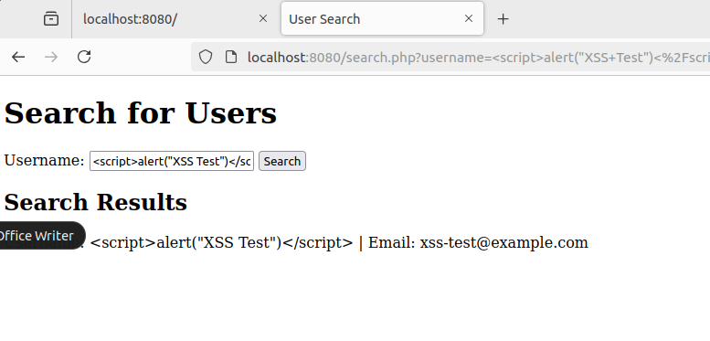

### 6.5 Database Configuration Protection

The database configuration file was moved outside the web application's document root to `/etc/secure-coding-review/db.php`.

File permissions were restricted to `640`, with ownership assigned to `root:www-data`. This limits access to authorized system users and the web server group.

The public repository contains only a sample configuration file (`db.example.php`) with placeholder credentials. Real database credentials are not published.

**Evidence – Secure database configuration:**

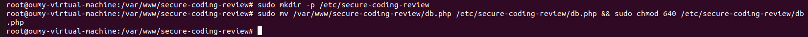

## 7. Final Security Testing

After implementing the security improvements, the application was tested again to verify that the identified vulnerabilities had been addressed.

| Security Test | Result |
|---|---|
| User registration | Successful |
| Password hashing | Verified in MariaDB |
| Authentication | Successful |
| SQL injection test | No unauthorized records returned |
| Stored XSS test | Script displayed as text; no alert executed |
| Database configuration permissions | Restricted to 640 |
| Semgrep final scan | 0 findings |

### 7.1 SQL Injection Retest

A manual SQL injection test was performed against the search functionality. The prepared SQL query prevented the test input from manipulating the database query.

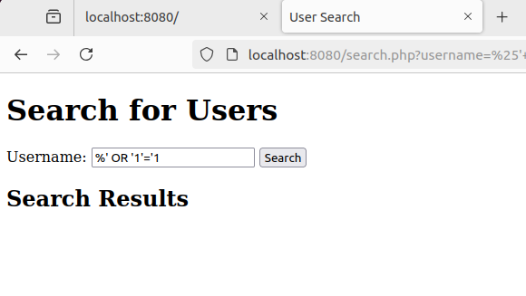

### 7.2 Final Static Analysis

The final Semgrep scan executed 85 rules and scanned four PHP files. It reported zero findings.

This result means that no issues were detected by the rules executed during this scan. It does not guarantee the complete absence of vulnerabilities.

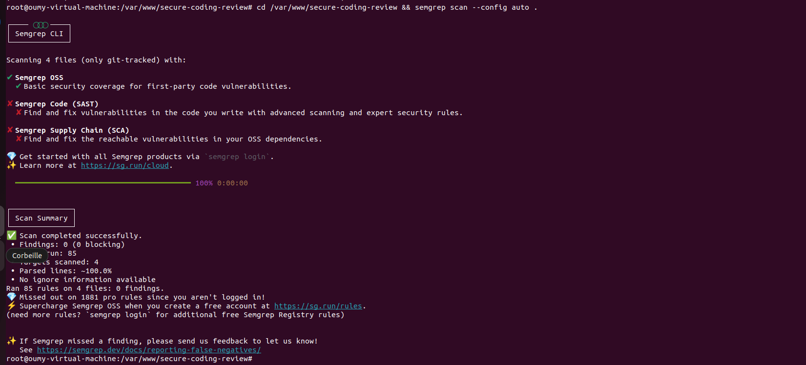

## 8. Security Recommendations

The following security practices are recommended for production environments:

- Enforce HTTPS across the application.
- Enable secure session cookie settings.
- Apply regular security updates to PHP, Apache and MariaDB.
- Use strong password policies and secure password hashing.
- Validate user input and encode output according to its context.
- Store sensitive configuration files outside the web root.
- Never publish database credentials in version control.
- Perform regular static analysis, code reviews and security testing.
- Apply least-privilege permissions to database accounts.

## 9. Conclusion

This project demonstrated a practical secure coding review process, from identifying vulnerabilities to implementing and validating remediation measures.

The initial assessment identified SQL injection risks, plaintext password storage and stored XSS. After remediation, prepared statements, password hashing, output encoding and improved configuration protection were implemented.

Manual retesting confirmed the expected security improvements, while the final Semgrep scan reported zero findings across the four scanned PHP files.

This project provided practical experience in application security assessment, vulnerability identification, secure PHP development and security testing.

---

**Author:** Astan Mve Sidibé  
**Master 1 – Information Systems Security**  
**ESMT – Senegal**  
**CodeAlpha Cyber Security Internship – November 2026**

