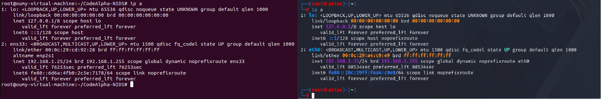
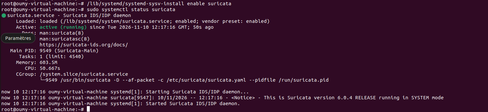

# Network Intrusion Detection System (NIDS) with Suricata

## Project Overview

This project implements a Network Intrusion Detection System (NIDS) using Suricata to monitor network traffic and detect suspicious activities.

The laboratory uses Ubuntu 22.04 as the intrusion detection server and Kali Linux as the testing machine. Custom Suricata rules are used to identify different network activities and generate security alerts.

## Objectives

- Install and configure Suricata.
- Monitor network traffic in real time.
- Create custom intrusion detection rules.
- Simulate network activities using Kali Linux.
- Analyze alerts and security events.

## Laboratory Overview





## Lab Environment

| Component | Details |
|---|---|
| Operating System (NIDS) | Ubuntu 22.04 |
| Testing Machine | Kali Linux |
| IDS Engine | Suricata 6.0.4 |
| Network Interface | ens33 |
| Ubuntu IP Address | 192.168.1.25 |
| Kali IP Address | 192.168.1.33 |
| Virtualization | VMware Workstation 17 Pro |

## Detection Scenarios

| SID | Detection Rule | Status |
|---|---|---|
| 1000001 | ICMP Ping Detection | Successful |
| 1000002 | Nmap SYN Scan Detection | Successful |
| 1000003 | HTTP POST Request Detection | Successful |
| 1000004 | Repeated SSH Connection Attempts | Successful |

## Project Structure

```text
CodeAlpha-NIDS/
├── README.md
├── rules/
│   └── local.rules
├── docs/
│   ├── architecture.md
│   └── installation.md
├── tests/
│   └── test-results.md
└── screenshots/
```

## Logs and Monitoring

Suricata generates security events in the following files:

- `/var/log/suricata/fast.log`
- `/var/log/suricata/eve.json`

These logs provide information about detected traffic, source and destination IP addresses, protocols, and alert signatures.

## Results

The laboratory successfully demonstrated the detection of four network traffic scenarios using custom Suricata rules.

A total of 53,290 rules were loaded, with zero rule-loading failures at the time of verification.

## Technologies Used

- Suricata
- Ubuntu Linux
- Kali Linux
- Nmap
- cURL
- VMware Workstation
- TCP/IP networking

## Project Context

This project was developed as part of the CodeAlpha Cyber Security Internship Program.

## Author

**Astan Mve Sidibé**

Master 1 Student in Information Systems Security at ESMT.

Background in Telecommunications and IT, specializing in Network Administration and Security.

Interested in cybersecurity, network security, and intrusion detection systems.
