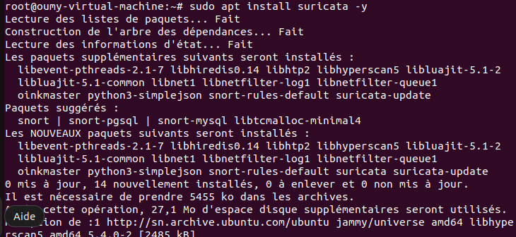
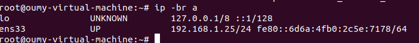
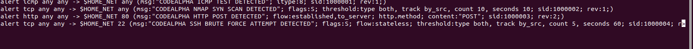
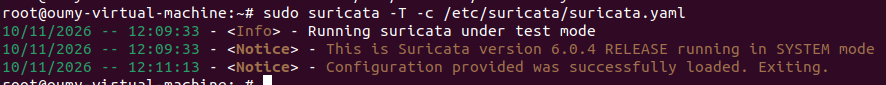
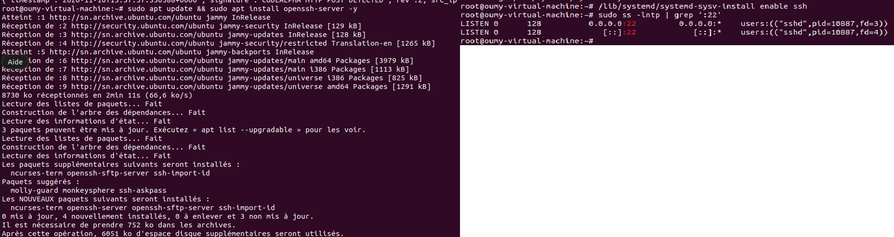

# Installation and Configuration Guide

## 1. Project Overview

This document describes the installation and configuration of Suricata, an open-source Network Intrusion Detection System (NIDS), as part of the CodeAlpha Cyber Security Internship.

The objective is to monitor network traffic, detect suspicious activities, and generate security alerts.

## 2. Laboratory Environment

The laboratory consists of two virtual machines running on VMware Workstation.

| Component | Description |
|---|---|
| Monitoring machine | Ubuntu 22.04 |
| Attacking machine | Kali Linux |
| NIDS software | Suricata 6.0.4 |
| Ubuntu IP address | 192.168.1.25 |
| Kali IP address | 192.168.1.33 |
| Network interface | ens33 |

## 3. Suricata Installation

Suricata was installed on the Ubuntu virtual machine using the following commands:

```bash
sudo apt update
sudo apt install suricata -y
```

The installed version was checked with:

```bash
suricata --build-info
```

## 4. Network Interface Configuration

Suricata was configured to monitor the Ubuntu network interface `ens33`.

The interface was identified using:

```bash
ip addr
```

The monitoring interface was configured in the Suricata configuration file:

```bash
sudo nano /etc/suricata/suricata.yaml
```

## 5. Custom Detection Rules

Custom detection rules were created to identify different types of network activity.

The local rules file is:

```bash
/var/lib/suricata/rules/local.rules
```

The rules cover the following scenarios:

- ICMP traffic detection.
- Nmap SYN scan detection.
- HTTP POST request detection.
- Repeated SSH connection attempts detection.

## 6. Configuration Validation

The Suricata configuration was tested using:

```bash
sudo suricata -T -c /etc/suricata/suricata.yaml
```

The rule-loading statistics were checked using:

```bash
sudo suricatasc -c ruleset-stats
```

The laboratory successfully loaded 53,290 rules with 0 rule-loading failures.

## 7. Service Management

Suricata was enabled and started using:

```bash
sudo systemctl enable suricata
sudo systemctl restart suricata
```

Its operational status was checked with:

```bash
sudo systemctl status suricata
```

## 8. SSH Service Preparation

The OpenSSH server was installed on Ubuntu to enable SSH connection testing:

```bash
sudo apt install openssh-server -y
sudo systemctl enable --now ssh
```

The SSH service was used to generate repeated connection attempts from Kali Linux for testing the custom detection rule.

## 9. Log Files

Suricata generated security alerts and network events in the following files:

- Fast alerts: `/var/log/suricata/fast.log`
- Detailed events: `/var/log/suricata/eve.json`

These logs were used to verify the detection results.

## 10. Conclusion

Suricata was successfully installed and configured on Ubuntu. The monitoring interface, custom detection rules, and logging mechanisms were prepared. The environment was then used to perform network security tests from Kali Linux.
