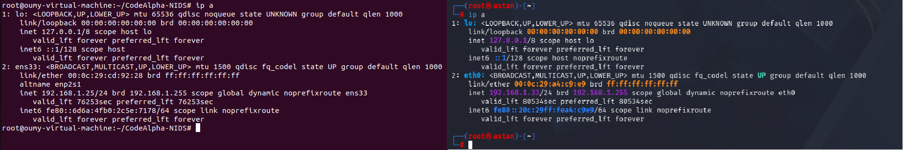
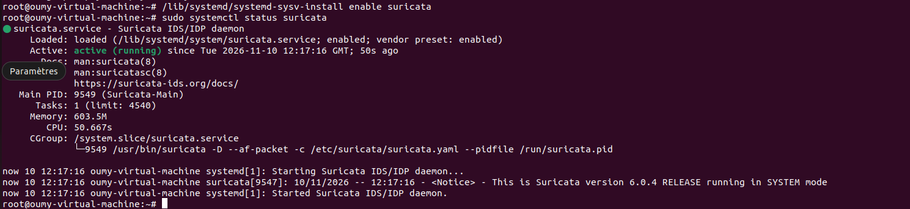
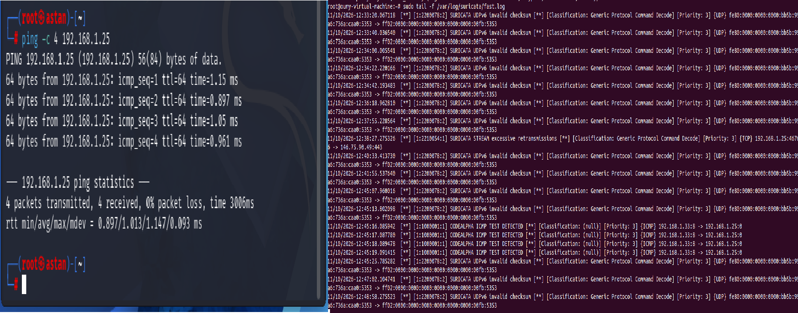
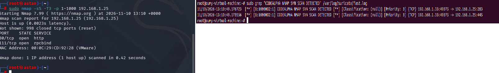
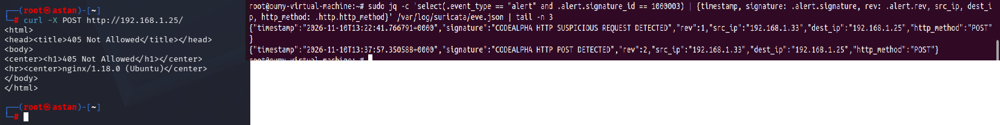
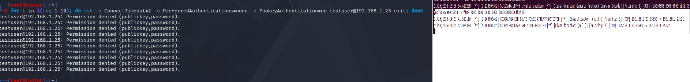

# NIDS Testing and Results

## 1. Test Environment

The tests were conducted using two virtual machines:

- **Ubuntu 22.04:** Suricata NIDS server (`192.168.1.25`)
- **Kali Linux:** Traffic generation and testing machine (`192.168.1.33`)


## 2. ICMP Detection Test

**Objective:** Verify that Suricata detects ICMP Echo Request packets.

**Command executed on Kali Linux:**

```bash
ping -c 4 192.168.1.25
```

**Expected result:** Suricata generates alerts for incoming ICMP Echo Requests.

**Observed result:** Four ICMP detection alerts were recorded in `fast.log`.

**Status:** Successful.

## 3. Nmap SYN Scan Detection Test

**Objective:** Detect repeated TCP SYN packets generated by a port scan.

**Command executed on Kali Linux:**

```bash
sudo nmap -sS -T3 -p 1-1000 192.168.1.25
```

**Expected result:** Suricata identifies repeated SYN packets and generates an alert.

**Observed result:** The custom SYN scan detection rule generated alerts in `fast.log`.

**Status:** Successful.

## 4. HTTP POST Detection Test

**Objective:** Detect HTTP POST requests sent to the Ubuntu web server.

**Command executed on Kali Linux:**

```bash
curl -X POST http://192.168.1.25/
```

**Expected result:** Suricata detects the HTTP POST method.

**Observed result:** An alert with SID `1000003` and signature `CODEALPHA HTTP POST DETECTED` was recorded in `eve.json`.

The web server returned HTTP status `405`, indicating that the requested method was not allowed on the resource. However, Suricata successfully detected the request.

**Status:** Successful.

## 5. SSH Connection Attempts Detection Test

**Objective:** Detect repeated TCP connection attempts targeting the SSH service.

**Command executed on Kali Linux:**

```bash
for i in $(seq 1 10); do ssh -o ConnectTimeout=2 -o PreferredAuthentications=none -o PubkeyAuthentication=no testuser@192.168.1.25 exit; done
```

**Expected result:** Suricata detects repeated TCP SYN packets targeting port 22.

**Observed result:** The custom rule with SID `1000004` generated an SSH connection attempt alert.

**Status:** Successful.

**Note:** This rule detects repeated TCP connection attempts, not failed password authentication itself.

## 6. Overall Results

All four custom detection scenarios were successfully tested.

Suricata reported 53,290 loaded rules and zero rule-loading failures during the final verification.

The results demonstrate the ability of Suricata to monitor network traffic and identify activities matching custom detection signatures.
